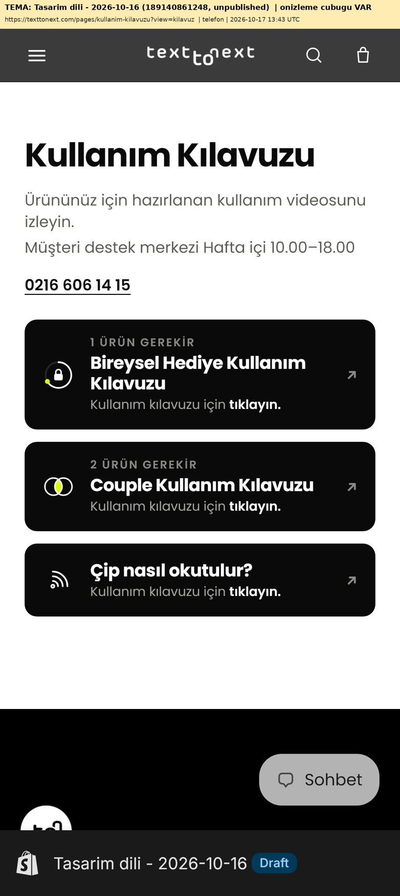
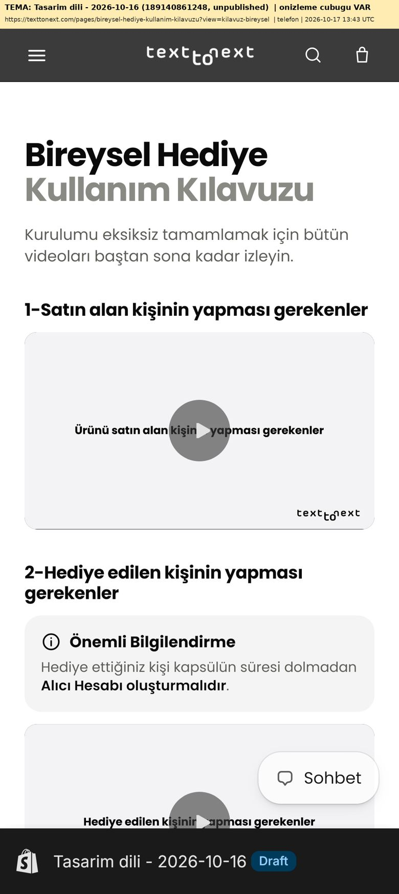
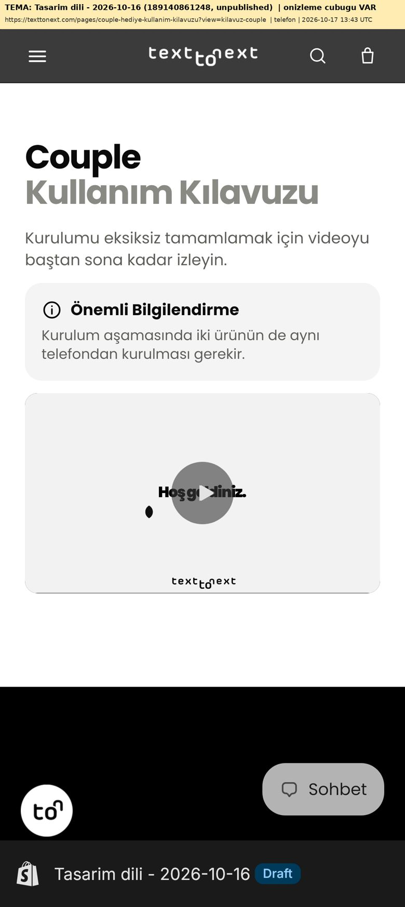
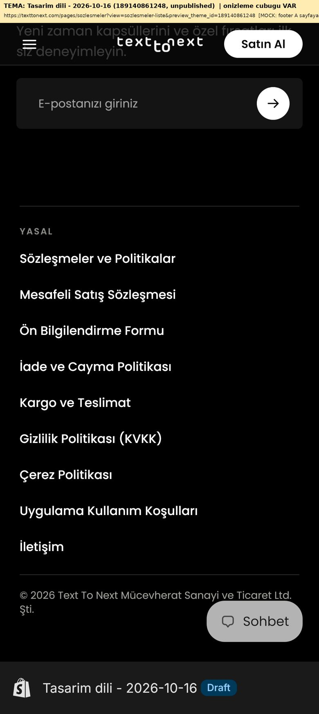
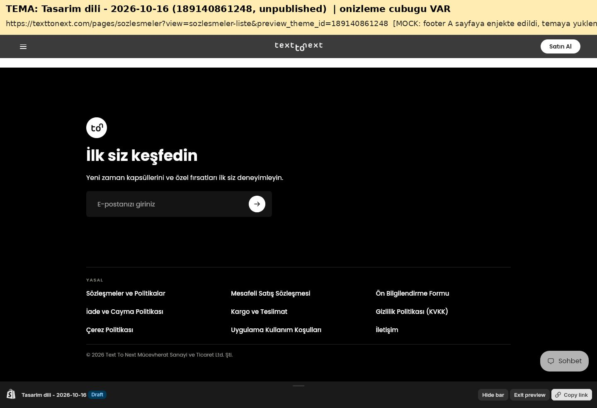
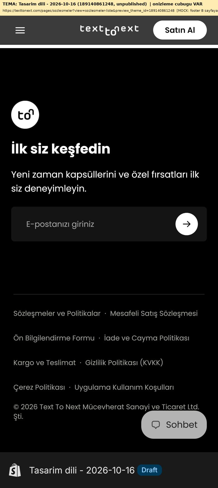
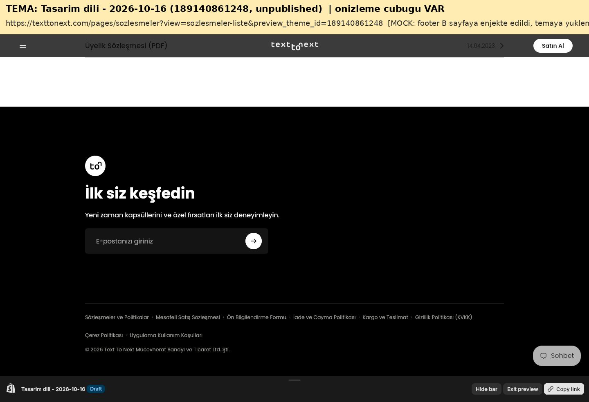
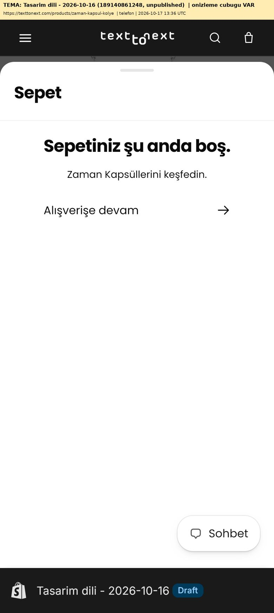
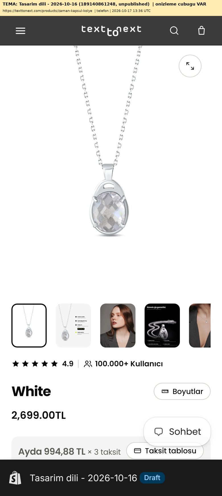
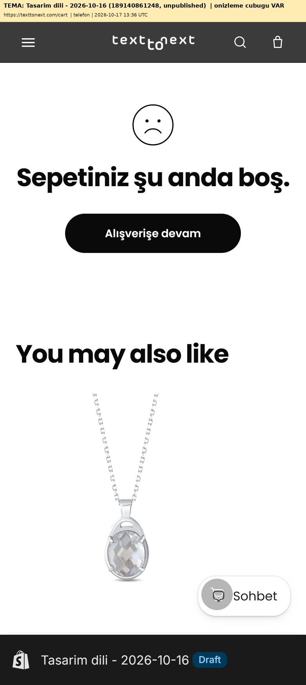

# Tasarım dili turu: rapor (17 Ekim 2026)

Tasarım dili dosyası: [`TEXT-TO-NEXT-TASARIM-DILI.md`](../../TEXT-TO-NEXT-TASARIM-DILI.md) (repo kökü, gönderdiğiniz dosyanın aynısı).

**Durum:** Aşağıdakilerin hepsi yalnızca taslak temada ("Tasarim dili - 2026-10-16", 189140861248). Hiçbir sayfanın adresi, handle'ı, yönlendirmesi ya da template suffix'i değişmedi. Menülere dokunulmadı. Yayındaki tema ("Calisma taslagi - 2026-10-05") değişmedi; son değişiklik tarihi hâlâ **2026-10-14 19:41 UTC**. Ekran görüntülerinin hepsinde önizleme çubuğu görünüyor. Her görüntünün üstündeki sarı şeritte hangi tema, hangi adres ve hangi cihaz olduğu yazıyor.

## Onayınızı bekleyenler

| # | Konu | Bölüm |
|---|---|---|
| 1 | Footer: A mı, B mi (ya da hiçbiri)? | [4](#4-footer-a--b-uygulanmadı) |
| 2 | Ana menüdeki (main-menu) "İletişim" linkini `/pages/iletisim` yapalım mı, ne zaman? | [5](#5-i̇letişim-linkleri) |
| 3 | `/collections/all` için öneri | [7](#7-collectionsall) |
| 4 | Masaüstü başlık boyutu (dosyada "belirlenmedi"; iki farklı boyut yan yana duruyor) | [3.2](#32-sizin-karar-vermeniz-gereken-noktalar) |
| 5 | Tasarım dili dosyası ile tema arasındaki farklar | [8](#8-tasarım-dili-dosyası-ile-tema-arasındaki-farklar) |

Önceki rapordan hâlâ bekleyenler: Madde 5 ürün ifadeleri listesi, K11 hesap silme metni (sayfa bu yüzden şu an boş), K16 test şablonlarının elle silinmesi, mağaza müşteri e-postasının `info@` yapılması.

---

## 1. Yapılan değişiklikler

### 1.1 Taslak temaya yüklenen dosyalar

Hepsi yüklendikten sonra Shopify'daki MD5 değeri repodaki dosyayla karşılaştırıldı; 20 dosyanın 20'si aynı.

| Dosya | Ne değişti | MD5 |
|---|---|---|
| `sections/tt-kilavuz.liquid` | Kılavuz bölümü baştan yazıldı: Poppins (temanın font değişkenleri, Inter yok), palet, 12px kart, 16px bilgi kutusu, marka simgeleri, kart linkleri temiz adres + `?view=kilavuz` iken çalışan küçük betik | `665750fe…` |
| `templates/page.kilavuz.json` | Ana kılavuz: saat "Hafta içi 10.00–18.00", kartlar temiz adrese bağlı | `2425f874…` |
| `templates/page.kilavuz-bireysel.json` | İki satırlı başlık ("Bireysel Hediye" / "Kullanım Kılavuzu") | `a4fcaa17…` |
| `templates/page.kilavuz-couple.json` | İki satırlı başlık ("Couple" / "Kullanım Kılavuzu") | `6dd693b0…` |
| `sections/legal-hub.liquid` | Sekmeler filtre çipi gibi (seçili #0A0A0A + beyaz; seçili olmayan beyaz + 1px #D2D2CD), başlık harf aralığı -1px, metin 15px/1.45, ara başlıklar 17px/700/-0.3px | `88a1d950…` |
| `sections/tt-yasal-stil.liquid` | Yasal sayfa ve hesap silme sayfası başlığı -1px, tablo başlığı #F4F4F4 | `27e484a3…` |
| `sections/tt-belge-listesi.liquid` | `/pages/sozlesmeler` listesi: başlık 32px/-1px, 1px #D2D2CD ayraçlar, 17px 500 satırlar, menüdeki ok | `94ffda26…` |
| `templates/page.sozlesmeler-liste.json` | Bölüm boşlukları | `b0f283be…` |
| `sections/tt-iletisim-stil.liquid` | Yeni, yalnızca stil: iletişim sayfasında başlık -1px, etiketler 11px/600/+1.3px, linkler ink + altı çizili, form alanları beyaz + 1px #D2D2CD + 12px köşe | `40afda04…` |
| `templates/page.contact.json` | Stil bölümü eklendi; dolgulu sosyal medya ikonları (24×24) kaldırıldı; saat "Hafta içi 10.00–18.00" | `60289067…` |
| `templates/page.gp-template-556461893263295681.json` | iletisimsayfasi (GemPages): saat "Hafta içi 10.00–18.00" | `453a007f…` |
| `templates/product.json`, `product.zaman-kapsulu.json`, `product.zaman-kapsulu-couple.json`, `product.couple.json` | Destek penceresinde saat "Hafta içi 10.00–18.00" | `4468cba7…`, `5c14e1da…`, `2c5bafaf…`, `3c07a54b…` |
| `sections/footer-group.json` | Eklediğim footer bölümü **kapatıldı** (silinmedi). `footer-yasal` menüsü ve bölümün içindeki Yasal bloğu duruyor. | `a124b4d8…` |
| `sections/tt-menu-grup.json`, `sections/tt-menu.liquid` | Hamburger menüdeki "İletişim" → `/pages/iletisim` | `a156acd6…`, `d4dbd4c2…` |
| `sections/cart-drawer.liquid` | Çekmecedeki "Alışverişe devam" artık link değil buton; yalnızca çekmeceyi kapatıyor | `7403c63e…` |
| `sections/main-cart.liquid` | `/cart` boşken "Alışverişe devam" → `/collections/zaman-kapsulu-bileklik` | `032000cb…` |

Değişiklik öncesi kopyalar repoda: commit `54890b4` (sepet, çekmece, 404, koleksiyon dosyaları). Diğerlerinin önceki hâli git geçmişinde.

### 1.2 Mağaza düzeyinde (tema dışı) yapılan tek değişiklik

- `/pages/iletisim` sayfasının **gövde metnindeki** saat "Hafta içi 10.00–18.00" yazıldı (K5 düzeltmeniz). Sayfa gövdesi temadan bağımsız olduğu için bu metin yayındaki sitede de görünür. Adres, handle ve şablon aynı.

### 1.3 Bu tur bulunup düzeltilen hata

İlk "sonra" görüntülerinde üç kılavuz sayfası **bomboş** çıktı. Sebep: tema her bölümün zeminini konumlu bir `::before` katmanıyla çiziyor; benim kılavuz içeriğim konumlu olmadığı için bu beyaz katmanın altında kaldı. Temanın kendi bölümleri bunu iç sarmalayıcıya `relative` vererek çözüyor; aynısını yaptım (commit `dcf6d42`). Yeniden yüklendi, MD5 doğrulandı, görüntüler yeniden alındı. Otomatik denetim bunu yakalayamadı, çünkü hesaplanan stillere bakıyor ve içerik stil olarak "görünür" durumdaydı. Bundan sonra her "sonra" görüntüsünü gözle de kontrol ediyorum.

---

## 2. Kılavuz link testi

**Ne yapıldı:**

- Kartlar temiz adrese bağlı:
  - `/pages/bireysel-hediye-kullanim-kilavuzu`
  - `/pages/couple-hediye-kullanim-kilavuzu`
- Linklerde `?view=` ya da `preview_theme_id` yok.
- Sayfa `?view=kilavuz` ile açıldığında küçük bir betik yalnızca bu iki kartın linkine `?view=kilavuz-bireysel` / `?view=kilavuz-couple` ekliyor. Betik `preview_theme_id` hiç eklemiyor.
- Betiğin üstünde "SUFFIX DEGISIKLIGINDEN SONRA KALDIRILACAK" notu var. Suffix'ler değişince betik, kart ayarındaki "Önizleme şablonu (geçici)" alanı ve `data-ttk-view` niteliği silinecek.
- Alt kılavuzlarda geri linki yok, bu yüzden ayrı bir düzeltme gerekmedi. Eklenirse adresi temiz `/pages/kullanim-kilavuzu` olacak.
- Şablonlar QR parametrelerine (`?_ab=0&key=…`, `?key=…`) bakmıyor.

**Sonuç (WebKit, iPhone 13 ve 1440×900; gerçek tıklama):**

| Adım | Telefon | Masaüstü |
|---|---|---|
| Sunucunun bastığı HTML'deki kart linkleri | `/pages/bireysel-hediye-kullanim-kilavuzu`, `/pages/couple-hediye-kullanim-kilavuzu` (temiz) | aynı |
| `?view=kilavuz` açıkken betikten sonra | `…?view=kilavuz-bireysel`, `…?view=kilavuz-couple` | aynı |
| Bireysel karta tıklandı | `/pages/bireysel-hediye-kullanim-kilavuzu?view=kilavuz-bireysel`, yeni şablon açıldı | aynı |
| Couple karta tıklandı | `/pages/couple-hediye-kullanim-kilavuzu?view=kilavuz-couple`, yeni şablon açıldı | aynı |
| QR adresi `?_ab=0&key=1767609525998` (+ `view=kilavuz`) | İçerik parametresiz sayfayla birebir aynı | aynı |
| QR adresi `?key=1767609525998` (+ `view=kilavuz`) | İçerik birebir aynı | aynı |
| QR adresinden bireysel karta tıklandı | Yeni alt kılavuz açıldı | aynı |

Görüntüler (`tasarim-dili-ekran/kilavuz-link/`):

| | Telefon | Masaüstü |
|---|---|---|
| 1. Ana kılavuz (`?view=kilavuz`) | [görüntü](tasarim-dili-ekran/kilavuz-link/1-ana-kilavuz-kartlar-telefon.jpg) | [görüntü](tasarim-dili-ekran/kilavuz-link/1-ana-kilavuz-kartlar-masaustu.jpg) |
| 2. Bireysel karta tıklandı | [görüntü](tasarim-dili-ekran/kilavuz-link/2-bireysel-karta-tiklandi-telefon.jpg) | [görüntü](tasarim-dili-ekran/kilavuz-link/2-bireysel-karta-tiklandi-masaustu.jpg) |
| 3. Couple karta tıklandı | [görüntü](tasarim-dili-ekran/kilavuz-link/3-couple-karta-tiklandi-telefon.jpg) | [görüntü](tasarim-dili-ekran/kilavuz-link/3-couple-karta-tiklandi-masaustu.jpg) |
| 4. QR `?_ab=0&key=…` | [görüntü](tasarim-dili-ekran/kilavuz-link/4-qr-ab-key-telefon.jpg) | [görüntü](tasarim-dili-ekran/kilavuz-link/4-qr-ab-key-masaustu.jpg) |
| 5. QR `?key=…` | [görüntü](tasarim-dili-ekran/kilavuz-link/5-qr-key-telefon.jpg) | [görüntü](tasarim-dili-ekran/kilavuz-link/5-qr-key-masaustu.jpg) |
| 6. QR adresinden karta tıklandı | [görüntü](tasarim-dili-ekran/kilavuz-link/6-qr-adresinden-bireysel-karta-tiklandi-telefon.jpg) | [görüntü](tasarim-dili-ekran/kilavuz-link/6-qr-adresinden-bireysel-karta-tiklandi-masaustu.jpg) |

  

Not: Yayından ve suffix değişikliğinden önce temiz adresler (`?view=` olmadan) hâlâ GemPages şablonunu gösterir. Bu beklenen durum.

---

## 3. Sayfa sayfa tasarım dili kontrolü

**Yöntem:**

- Her sayfa telefonda (iPhone 13) ve masaüstünde (1440×900) açıldı.
- Yalnızca sayfanın kendi içeriği (`#MainContent`) otomatik olarak ölçüldü: renkler, neon, font, başlık harf aralığı, butonlar, dokunma alanları, ikonlar, köşeler, gölgeler ve kontrast.
- Bunun üstüne görüntüler tek tek gözle kontrol edildi.
- Ham ölçümler `tasarim-dili-ekran/once/denetim.json` ve `tasarim-dili-ekran/sonra/denetim.json` dosyalarında.

### 3.1 Önce / sonra özeti

| Sayfa | Önce (sorunlar) | Sonra |
|---|---|---|
| Kullanım kılavuzu (`/pages/kullanim-kilavuzu`) | Palet dışı 4 renk (#181B1E, #4D4D4D, #D4D4D0, kırmızı #E8423B), Inter fontu, 7 neon öğe, gri gölgeler, 10px köşeler, başlık -0.6px, telefon linki 107×19 | Palet dışı 0, yalnızca Poppins, neon 2 (iki marka simgesi), gölge 0, köşeler 12px, başlık 32/700/-1px, küçük hedef 0 |
| Bireysel kılavuz | Palet dışı 3 (kırmızı #D32017 dahil), Inter, başlıklar -0.6/-0.36px | Palet dışı 0, Poppins, iki satırlı başlık (ink + #8A8A85), ara başlıklar 17/700/-0.3px, bilgi kutusu 16px |
| Couple kılavuz | Palet dışı 3, Inter, başlık -0.6px | Palet dışı 0, Poppins, iki satırlı başlık, bilgi kutusu 16px |
| Merkez sayfa (`/pages/sozlesmeler-ve-politikalar`) | Başlık -1.92px (telefon) / -3.88px (masaüstü), seçili olmayan sekmeler saydam | Başlık -1px, sekmeler çip: seçili ink + beyaz, seçili olmayan beyaz + 1px #D2D2CD, hepsi 44px yüksek |
| Yasal sayfa (örnek: Mesafeli Satış) | Başlık -1.92px / -3.88px | Başlık -1px |
| Sözleşmeler listesi (`/pages/sozlesmeler`, `?view=sozlesmeler-liste`) | Palet dışı 4 (#4D4D4D, #E3E3DF, #181B1E, #6B6B66), başlık -0.6px | Palet dışı 0, başlık 32/700/-1px, satırlar 56px, oklar #5C5C57 |
| Hesap silme talebi | Başlık -1.92px / -3.88px | Başlık -1px. Gövde metni boş (K11 onayınızı bekliyor) |
| İletişim (`/pages/iletisim`, `?view=contact`) | Saydam renkler (%2.4 ve %50 ink), degrade alt çizgi, 6px form köşeleri, küçük hedefler (info@ 165×23, sosyal ikonlar 24×24), dolgulu ikonlar | Palet dışı 0, form alanları 12px + 1px #D2D2CD, linkler ink + altı çizili, küçük hedef 0, dolgulu ikon 0 |

Görüntüler (her sayfa için tam sayfa; telefonda en fazla ilk 9.000px, masaüstünde 16.000px):

| Sayfa | Önce telefon | Önce masaüstü | Sonra telefon | Sonra masaüstü |
|---|---|---|---|---|
| Kullanım kılavuzu | [önce](tasarim-dili-ekran/once/ONCE-kilavuz-telefon.jpg) | [önce](tasarim-dili-ekran/once/ONCE-kilavuz-masaustu.jpg) | [sonra](tasarim-dili-ekran/sonra/SONRA-kilavuz-telefon.jpg) | [sonra](tasarim-dili-ekran/sonra/SONRA-kilavuz-masaustu.jpg) |
| Bireysel kılavuz | [önce](tasarim-dili-ekran/once/ONCE-kilavuz-bireysel-telefon.jpg) | [önce](tasarim-dili-ekran/once/ONCE-kilavuz-bireysel-masaustu.jpg) | [sonra](tasarim-dili-ekran/sonra/SONRA-kilavuz-bireysel-telefon.jpg) | [sonra](tasarim-dili-ekran/sonra/SONRA-kilavuz-bireysel-masaustu.jpg) |
| Couple kılavuz | [önce](tasarim-dili-ekran/once/ONCE-kilavuz-couple-telefon.jpg) | [önce](tasarim-dili-ekran/once/ONCE-kilavuz-couple-masaustu.jpg) | [sonra](tasarim-dili-ekran/sonra/SONRA-kilavuz-couple-telefon.jpg) | [sonra](tasarim-dili-ekran/sonra/SONRA-kilavuz-couple-masaustu.jpg) |
| Merkez sayfa | [önce](tasarim-dili-ekran/once/ONCE-merkez-legal-hub-telefon.jpg) | [önce](tasarim-dili-ekran/once/ONCE-merkez-legal-hub-masaustu.jpg) | [sonra](tasarim-dili-ekran/sonra/SONRA-merkez-legal-hub-telefon.jpg) | [sonra](tasarim-dili-ekran/sonra/SONRA-merkez-legal-hub-masaustu.jpg) |
| Yasal sayfa | [önce](tasarim-dili-ekran/once/ONCE-yasal-sayfa-telefon.jpg) | [önce](tasarim-dili-ekran/once/ONCE-yasal-sayfa-masaustu.jpg) | [sonra](tasarim-dili-ekran/sonra/SONRA-yasal-sayfa-telefon.jpg) | [sonra](tasarim-dili-ekran/sonra/SONRA-yasal-sayfa-masaustu.jpg) |
| Sözleşmeler listesi | [önce](tasarim-dili-ekran/once/ONCE-sozlesmeler-liste-telefon.jpg) | [önce](tasarim-dili-ekran/once/ONCE-sozlesmeler-liste-masaustu.jpg) | [sonra](tasarim-dili-ekran/sonra/SONRA-sozlesmeler-liste-telefon.jpg) | [sonra](tasarim-dili-ekran/sonra/SONRA-sozlesmeler-liste-masaustu.jpg) |
| Hesap silme | [önce](tasarim-dili-ekran/once/ONCE-hesap-silme-talebi-telefon.jpg) | [önce](tasarim-dili-ekran/once/ONCE-hesap-silme-talebi-masaustu.jpg) | [sonra](tasarim-dili-ekran/sonra/SONRA-hesap-silme-talebi-telefon.jpg) | [sonra](tasarim-dili-ekran/sonra/SONRA-hesap-silme-talebi-masaustu.jpg) |
| İletişim | [önce](tasarim-dili-ekran/once/ONCE-iletisim-telefon.jpg) | [önce](tasarim-dili-ekran/once/ONCE-iletisim-masaustu.jpg) | [sonra](tasarim-dili-ekran/sonra/SONRA-iletisim-telefon.jpg) | [sonra](tasarim-dili-ekran/sonra/SONRA-iletisim-masaustu.jpg) |

Tam sayfa görüntülerde önizleme çubuğu sayfanın ortasında görünebilir. Çubuk ekrana sabitlendiği için görüntü bu konumda yakalanıyor. Müşteri bu çubuğu görmez.

### 3.2 Kontrol listesi (bölüm 10), sayfa sayfa

✓ = geçti (telefon ve masaüstü). Açıklama gereken yerler tablonun altında.

| Madde | Kılavuz | Bireysel | Couple | Merkez | Yasal | Sözleşmeler | Hesap silme | İletişim |
|---|---|---|---|---|---|---|---|---|
| 1. Yalnızca palet, degrade yok | ✓ | ✓ | ✓ | ✓ | ✓ | ✓ | ✓ | ✓ |
| 2. Neon küçük, en fazla 1-2 yer, açık zeminde neon yazı yok | ✓ (2, a) | ✓ (0) | ✓ (0) | ✓ (0) | ✓ (0) | ✓ (0) | ✓ (0) | ✓ (0) |
| 3. Poppins, başlıklar 700 + kurala uygun harf aralığı, yeni font yok | ✓ | ✓ | ✓ | ✓ | ✓ | ✓ | ✓ | ✓ (b) |
| 4. Vurgu gerekiyorsa iki satırlı başlık | gerekmedi | ✓ | ✓ | gerekmedi | gerekmedi | gerekmedi | gerekmedi | gerekmedi |
| 5. Butonlar tam yuvarlak, doğru renkler, mavi link yok | ✓ (c) | ✓ | ✓ | ✓ | ✓ | ✓ | ✓ | ✓ |
| 6. Dokunma alanı ≥ 44×44 | ✓ | ✓ | ✓ | ✓ | ✓ | ✓ | ✓ | ✓ |
| 7. İnce çizgili, tek renk, dolgusuz ikon | ✓ (a, d) | ✓ | ✓ | ✓ | ✓ | ✓ (d) | ✓ | ✓ |
| 8. Köşeler 12/16/24/pill, gereksiz gölge yok | ✓ | ✓ | ✓ | ✓ | ✓ | ✓ | ✓ | ✓ (e) |
| 9. Kontrast 4.5:1 (24px+ 3:1) | ✓ | ✓ | ✓ | ✓ | ✓ | ✓ | ✓ | ✓ |
| 10. İşlevler bozulmadı, yalnızca kopya temada, yayındaki tema değişmedi | ✓ (f) | ✓ | ✓ | ✓ | ✓ | ✓ | ✓ | ✓ (g) |

**Notlar:**

- **a)** Neon ve dolgu yalnızca marka simgelerinde: Single'ın kilit noktası ve Couple'ın kesişimi. Simgeler dosyadaki SVG'lerin aynısı. Dolgulu oldukları için ikon maddesinin istisnası sayılır; üzerlerinde yazı yok. Single halkası menüdeki gibi #262624 (bkz. [8](#8-tasarım-dili-dosyası-ile-tema-arasındaki-farklar)).
- **b)** Sayfa yalnızca temanın Poppins dosyalarını yüklüyor (400, 500, 600, 700, 400 italik). Ölçümde görünen iki font daha var, ikisi de temadan değil:
  - Inter: önizleme çubuğunun kendi fontu, yalnızca önizlemede yükleniyor.
  - GT Standard: Shopify'ın Shop Pay giriş penceresine ait (shop.app); yayındaki sitede de var.
- **c)** Kılavuz kartları buton değil, tam kart linki. Stil: #0A0A0A, 12px, yanında çapraz ok. Ok menü kartlarındaki gibi 14px #8A8A85.
- **d)** Oklar menüdeki değerlerle aynı:
  - Koyu kartta çapraz ok 14px #8A8A85.
  - Açık zeminde satır oku 10×16 #5C5C57.
  - Dosyanın genel kuralı "koyu zeminde ikon #FFFFFF" diyor. Menü ok rengini ayrıca tanımladığı için onu izledim.
- **e)** "Mesaj gönder" butonunda temanın saydam, sıfır boyutlu bir gölge tanımı var; görünmüyor.
- **f)** Kart linkleri ve `?view=` betiği test edildi (bölüm 2).
- **g)** Form alanları test edildi ama gerçek bir mesaj gönderilmedi (mağazaya sahte e-posta düşmesin diye).
- **Yayındaki tema:** "Calisma taslagi - 2026-10-05", son değişiklik 2026-10-14 19:41 UTC; bu turda değişmedi.

#### Sizin karar vermeniz gereken noktalar

- **Masaüstü başlık boyutu belirlenmedi.**
  - Kılavuz ve sözleşmeler listesi benim bölümlerim. Başlıkları telefon değerinde kaldı (32px, masaüstünde de).
  - Merkez sayfa, yasal sayfalar, hesap silme ve iletişim temanın kendi başlığını kullanıyor: telefonda 48px, masaüstünde 97px. Bunlarda yalnızca harf aralığını düzelttim; dosya da "mevcut tema bölümlerinin boyutlarına dokunulmadı" diyor.
  - Masaüstünde iki farklı başlık boyutu yan yana duruyor. Hangisinin esas olacağını söylerseniz eşitlerim.
- **Masaüstü genişliği belirlenmedi.**
  - Kılavuz: masaüstünde ortalanmış dar tek sütun (K14). En fazla 440px; bu değer dosyadaki "masaüstünde alttan açılan pencere en fazla 440px"tan alındı.
  - Sözleşmeler listesi temanın dar sayfa genişliğini kullanıyor (en fazla 70rem).
- **Form alanı stili dosyada tanımlı değil.** İletişim formunda iki tanımlı değerden türettim: "seçili olmayan çip kenarı" (1px #D2D2CD) ve radius-sm (12px). Odakta kenar ink oluyor.

---

## 4. Footer A / B (uygulanmadı)

**Şu anki durum:** Eklediğim footer taslak temada kapalı. `footer-yasal` menüsü ve bölümdeki Yasal bloğu duruyor. Taslakta newsletter'ın altında artık bir şey yok.

**Hazırlık:**

- İki versiyon tek bir bölüm dosyasında, "Düzen: A / B" ayarıyla seçiliyor: [`footer-oneri/tt-footer-yasal.liquid`](footer-oneri/tt-footer-yasal.liquid).
- Dosya temaya **yüklenmedi**.
- Linkler `footer-yasal` menüsünden okunuyor: merkez sayfa + 7 belge. Tema editöründe "Menü" ayarından değiştirilebilir.
- A'daki "İletişim" linki ayrı bir ayar. Böylece menüye dokunmak gerekmedi; adres boşsa `/pages/iletisim`.
- Görüntüler gerçek taslak tema sayfasında alındı (`/pages/sozlesmeler?view=sozlesmeler-liste`). Bölümün CSS'i ve HTML'i newsletter'ın hemen arkasına tarayıcıda eklendi; yani bunlar **mock**.
- Önizleme çubuğu telif satırını örtmesin diye mock'un altına 96px siyah boşluk eklendi. Bu boşluk gerçek footer'da yok.

### A: Tam

 

- Newsletter'ın altında 1px #262624 çizgi.
- "YASAL" etiketi: 11px, 600, +1.3px, büyük harf, #8A8A85.
- 8 yasal link ve İletişim alt alta: beyaz, Poppins 500, 15px, her satır 44px.
- En altta 1px #262624 çizgi ve telif satırı (12.5px, #A3A39E).
- Düzen: telefonda tek sütun, tabletlerde 2, masaüstünde 3 sütun.
- Yükseklik: telefonda 525px, masaüstünde 244px.

### B: Minimal

 

- İnce çizgi, ardından yasal linkler yan yana: 12.5px, #A3A39E, aralarında nokta.
- Satır başına düşen nokta gizleniyor, yani hiçbir satır noktayla başlamıyor.
- Sonra telif satırı.
- Yükseklik: telefonda 251px, masaüstünde 102px.

### Türetilen değerler (dosyada footer "belirlenmedi")

| Değer | Seçim | Kaynağı |
|---|---|---|
| A link boyutu | 15px 500 | İsteğiniz: "menü alt linklerinin ölçeğine yakın, küçültülmüş". Menü alt linkleri 17px; 15px gövde ölçeği. |
| Satır yüksekliği (A ve B) | 44px | En küçük dokunma alanı (madde 6). B telefonda bu yüzden 4 satır sürüyor. |
| Dikey boşluklar | 24 / 12 / 16px | space-6 / space-3 / space-4 |
| Telefonda kenar | 24px | İsteğiniz. Newsletter temanın 20px kenarını kullanıyor; telefonda footer metni newsletter'dan 4px içeride başlıyor. İsterseniz 20px yaparım. |
| Masaüstü genişlik | Newsletter'ın genişliği (temanın dar sayfa genişliği) | Bir bütün gibi dursun diye newsletter'la aynı hizada |
| Odak halkası | 2px #FFFFFF | "Odak halkası koyu zeminde #FFFFFF" |
| Hover | yok | Belirlenmedi |
| Bulunulan sayfa | `aria-current="page"`; B'de o link beyaz | Menüdeki kural |

### Seçtiğinizde yapılacaklar

1. `sections/tt-footer-yasal.liquid` taslak temaya yüklenir.
2. `footer-group.json` içinde newsletter'ın arkasına bu bölüm eklenir; "Menü" `footer-yasal`, "Düzen" seçtiğiniz harf olur. Shopify bölüm şemasında menünün varsayılanı yalnızca `main-menu` ya da `footer` olabiliyor; bu yüzden `footer-yasal` şablon dosyasında ayarlanacak.
3. Kapalı eski footer bölümü kapalı kalır.

İsterseniz newsletter'ın alt boşluğu (72px) da biraz azaltılabilir. Böylece çizgiye kadar olan boşluk kısalır. Bunu ayrıca sorarım.

---

## 5. İletişim linkleri

**Yapılan:** Hamburger menüdeki "İletişim" artık `/pages/iletisim`'e gidiyor (taslak tema, `tt-menu-grup.json` ve bölümün varsayılanı).

**Sitedeki diğer İletişim linkleri:**

Tarama: taslak temanın 694 dosyasının tamamı indirilip arandı (`/pages/iletisim`, `/pages/iletisimsayfasi`, `/pages/contact…`, `routes.contact_url`, `shopify://pages/…`). Satır numaraları Shopify kod düzenleyicisindeki satırlar. JSON dosyalarında Shopify'ın otomatik başlık yorumu da sayıldığı için repodaki kopyadan birkaç satır farklı olabilir.

| Yer | Nerede | Bugün nereye gidiyor | Durum / öneri |
|---|---|---|---|
| Hamburger menü "İletişim" | `sections/tt-menu-grup.json:43` (ayar), `sections/tt-menu.liquid:32` (boşsa varsayılan) | `/pages/iletisim` | **Bu turda değişti** (taslak tema) |
| Ana menü (`main-menu`) "İletişim" | Mağaza menüsü (tema dosyası değil) | `/pages/iletisimsayfasi` | **Öneri:** `/pages/iletisim`. Onayınızla; zamanlaması aşağıda. |
| Footer menüsü (`footer`) "İletişim" | Mağaza menüsü | `/pages/iletisim` | Zaten doğru |
| Footer A önerisi | `footer-oneri/tt-footer-yasal.liquid` | `/pages/iletisim` | Yüklenmedi |
| GemPages "Bize ulaşın" + "Sizi arayalım" | `sections/gp-section-556458005730690241.liquid:70, 106, 139, 175`; sayfa: `/pages/text-to-next-pro-1` | `/pages/iletisimsayfasi` | Sayfa taşınınca kalkıyor (K4). iletisimsayfasi da yeni şablonu alacağı için link kırılmıyor. |
| GemPages "Bize ulaşın." | `sections/gp-section-548576702909907875.liquid:75, 106`; sayfalar: `landing-page-dec-12-23-44-18` ("Ana Sayfa", yayında) ve `ana-sayfa` (yayında değil) | `https://texttonext.com/pages/iletisim` (tam adres) | Zaten yeni sayfaya gidiyor. GemPages'in ürettiği kod: elle değiştirilirse GemPages yeniden yayınlayınca geri gelir. Taşımada kalkıyor. |
| GemPages "Bize ulaşın." | `sections/gp-section-588198910976066134.liquid:75, 106` ve `sections/gp-section-588203443760399163.liquid:75, 106`; sayfa: `landing-page-apr-7-16-02-03` | `https://texttonext.com/pages/iletisim` (tam adres) | Aynı |
| Ürün sayfaları, destek penceresi | `templates/product*.json` (`pop_metin`) | Sayfa linki yok; `tel:` ve `mailto:info@texttonext.com` | Değişiklik gerekmiyor |
| Merkez sayfa alt satırı | `sections/legal-hub.liquid` | `mailto:info@texttonext.com` | Değişiklik gerekmiyor |
| Sepet (çekmece ve `/cart`) | – | İletişim linki yok | – |
| Yönlendirme | `/pages/contact-page-mar-5-21-32-02` → `/pages/iletisimsayfasi` | – | Kural gereği olduğu gibi kalıyor |
| `/pages/contact` (başlık "Contact") | Sayfa zaten `contact` şablonunu kullanıyor | – | Yayından sonra yeni iletişim tasarımıyla açılacak; sekme başlığı "Contact" |

**Önerim:**

1. **Ana menü (`main-menu`) "İletişim" → `/pages/iletisim`.**
   - Bunu taslak temayı yayına aldığınız gün, `/pages/iletisim` sayfasının suffix'i `contact` yapıldıktan **sonra** yapmayı öneriyorum.
   - Sebebi: menüler mağaza genelinde; değişiklik anında yayındaki siteye geçer.
   - Yayındaki temada `/pages/iletisim` bugün formu olmayan düz bir metin sayfası olarak açılıyor. `iletisimsayfasi` ise (GemPages) formlu.
   - Erken değiştirirsek ana menüden gelen ziyaretçi bir süre formsuz sayfa görür.
   - Onayınızla yaparım.
2. **`/pages/iletisimsayfasi` silinmiyor, adresi değişmiyor** (GemPages taşıma planına eklendi). Taşımada:
   - Bu sayfanın suffix'i `gp-template-556461893263295681` yerine `contact` olur, yani aynı yeni iletişim şablonu. Eski adres de yeni sayfayı gösterir.
   - Önizleme bugün de mümkün: `/pages/iletisimsayfasi?view=contact&preview_theme_id=189140861248`.
   - Bu sayfanın başlığı "Contact Page - Mar 5, 21:32:02". Sayfadaki büyük başlık şablondan geldiği için "İletişim" görünür. Ancak tarayıcı sekmesinde bu eski başlık yazar. Taşımada başlığın "İletişim" yapılmasını öneriyorum; adres ve handle değişmez.
   - `/pages/contact-page-mar-5-21-32-02` → `/pages/iletisimsayfasi` yönlendirmesi olduğu gibi kalır.
3. **Footer menüsü (`footer`)** zaten `/pages/iletisim`'e gidiyor; değişiklik gerekmiyor.
4. **GemPages bölümlerindeki `iletisimsayfasi` linkleri:** Bu sayfalar taşınınca (K18) zaten kalkıyor; ayrı bir değişiklik gerekmiyor. iletisimsayfasi da yeni sayfayı göstereceği için link kırılmıyor.

Güncellenmiş suffix listesi (yayından **sonra**; önceki raporun tablosuna eklendi):

| Sayfa | Şu anki suffix | Yeni suffix |
|---|---|---|
| `/pages/iletisim` | (boş) | `contact` |
| `/pages/iletisimsayfasi` | `gp-template-556461893263295681` | `contact` (yeni) |

---

## 6. Sepet butonları testi

**Yapılan:**

- **Çekmece boşken "Alışverişe devam":**
  - Artık `<button type="button">`.
  - Tıklanınca çekmecenin kendi `hide()` yöntemiyle kapanıyor; X ile aynı yol.
  - Odak çekmeceyi açan sepet ikonuna dönüyor.
  - Dinleyici belgeye bağlı olduğu için sepet yeniden çizilince de çalışıyor.
- **Çekmece doluyken:** "Alışverişe dön/devam" butonu yok (taslak temada telefon ve masaüstünde kontrol edildi). Değiştirilecek bir şey çıkmadı.
- **`/cart` boşken "Alışverişe devam"** → `/collections/zaman-kapsulu-bileklik`.

**Test (ürün sayfası `/products/zaman-kapsul-kolye` üzerinden, gerçek tıklama):**

| Adım | Telefon | Masaüstü |
|---|---|---|
| Boş çekmece açıldı; "Alışverişe devam" ne? | `BUTTON type=button`, href yok, 266×44 | `BUTTON type=button`, href yok, 288×44 |
| "Alışverişe devam" tıklandı | Çekmece kapandı (`open` yok, `hidden` var), adres aynı (`/products/zaman-kapsul-kolye`), odak sepet ikonunda | aynı |
| Karşılaştırma: X ile kapatma | Aynı sonuç: odak sepet ikonunda (d) | Aynı sonuç (fare tıklaması) |
| Klavye: butona odaklanıp Enter | Çekmece kapandı, odak sepet ikonunda | aynı |
| Dolu çekmece | "Alışverişe devam/dön" yok | yok |
| `/cart` boş: buton adresi | `/collections/zaman-kapsulu-bileklik` | aynı |
| `/cart` boş: buton tıklandı | `/collections/zaman-kapsulu-bileklik` açıldı | aynı |

(d) Telefonda X'e otomasyonun fare tıklaması çekmece başlığına takıldı. X'in kendi tıklaması (DOM click) ile denendi; sonuç aynı.

Görüntüler (`tasarim-dili-ekran/sepet/`):

| | Telefon | Masaüstü |
|---|---|---|
| Boş çekmece açık | [görüntü](tasarim-dili-ekran/sepet/A1-bos-cekmece-acik-telefon.jpg) | [görüntü](tasarim-dili-ekran/sepet/A1-bos-cekmece-acik-masaustu.jpg) |
| "Alışverişe devam" sonrası | [görüntü](tasarim-dili-ekran/sepet/A2-alisverise-devam-tiklandi-telefon.jpg) | [görüntü](tasarim-dili-ekran/sepet/A2-alisverise-devam-tiklandi-masaustu.jpg) |
| X ile kapatma (karşılaştırma) | [görüntü](tasarim-dili-ekran/sepet/A3-karsilastirma-X-ile-kapatildi-telefon.jpg) | [görüntü](tasarim-dili-ekran/sepet/A3-karsilastirma-X-ile-kapatildi-masaustu.jpg) |
| Klavye ile kapatma | [görüntü](tasarim-dili-ekran/sepet/A4-klavye-enter-ile-kapatildi-telefon.jpg) | [görüntü](tasarim-dili-ekran/sepet/A4-klavye-enter-ile-kapatildi-masaustu.jpg) |
| Dolu çekmece | [görüntü](tasarim-dili-ekran/sepet/B-dolu-cekmece-telefon.jpg) | [görüntü](tasarim-dili-ekran/sepet/B-dolu-cekmece-masaustu.jpg) |
| `/cart` boş | [görüntü](tasarim-dili-ekran/sepet/C1-sepet-sayfasi-bos-telefon.jpg) | [görüntü](tasarim-dili-ekran/sepet/C1-sepet-sayfasi-bos-masaustu.jpg) |
| `/cart` butonundan sonra | [görüntü](tasarim-dili-ekran/sepet/C2-sepet-bos-link-tiklandi-telefon.jpg) | [görüntü](tasarim-dili-ekran/sepet/C2-sepet-bos-link-tiklandi-masaustu.jpg) |

  

**Testte görülen, bu turda değiştirilmeyen iki metin:**

- Çekmecedeki X'in ekran okuyucu etiketi "Kapalı" (doğrusu "Kapat").
- Boş `/cart` sayfasındaki öneri başlığı İngilizce: "You may also like".

İkisi de temanın dil dosyasından geliyor. İsterseniz düzeltirim.

---

## 7. `/collections/all`

### 7.1 `/collections/all`'a giden linkler

Tarama: taslak temanın 694 dosyasının tamamı (`collections/all`, `shopify://collections/all`, `routes.all_products_collection_url`). Satır numaraları Shopify kod düzenleyicisindeki satırlar.

| Nerede | Ne | Ziyaretçi görüyor mu? | Durum / öneri |
|---|---|---|---|
| `sections/cart-drawer.liquid` (eski satır 61) | Boş çekmecedeki "Alışverişe devam" | – | **Bu turda butona çevrildi**, artık link değil |
| `sections/main-cart.liquid:41` | `/cart` boşken "Alışverişe devam" | – | **Bu turda** `/collections/zaman-kapsulu-bileklik` yapıldı |
| `sections/main-cart.liquid:22` | `/cart` doluyken başlığın yanındaki "Alışverişe devam" | Evet | B ile çevrilebilir |
| `sections/main-404.liquid:25` | 404 sayfasındaki "Alışverişe devam" | Evet | B ile çevrilebilir |
| `sections/main-collection.liquid:214` | Ürünü olmayan koleksiyonda çıkan buton | Yalnızca boş koleksiyonlarda (ör. `omur-boyu-garantili-celik-zaman-kapsulleri`, 0 ürün) | B ile çevrilebilir |
| `assets/tt-tekli-secim.js:49` | Kadın/Erkek grubunun adresi yoksa kullanılan yedek | Normalde hayır (adresler dolu) | Dokunmayı önermiyorum |
| `sections/header-group.json:78, 84, 98, 112, 126` | Eski tema header'ının mega menü bloğu ("View All Products") | Hayır: blok kapalı | Gerek yok |
| `sections/overlay-group.json:316` | Mobil alt çubuk (mobile dock) bağlantısı | Hayır: bölüm kapalı | Gerek yok |
| `blocks/button.liquid:161` | Şema ön ayarı (yeni blok eklenince gelen değer) | Hayır | Dokunmayı önermiyorum |
| `sections/ss-glow-features.liquid:234` | Şema varsayılanı | Hayır | Dokunmayı önermiyorum |
| `snippets/button.liquid:25` | Yorum içindeki kullanım örneği | Hayır (hiç basılmıyor) | – |
| Arama sayfası | – | `/collections/all` linki yok | – |

Menüler (`main-menu`, `footer`, `footer-yasal`, müşteri hesabı menüsü): hiçbirinde `/collections/all` yok.

### 7.2 Sayfanın bugünkü hâli

Görüntüler: [telefon](tasarim-dili-ekran/koleksiyon/SIMDI-collections-all-telefon.jpg), [masaüstü](tasarim-dili-ekran/koleksiyon/SIMDI-collections-all-masaustu.jpg). Ölçümler: `tasarim-dili-ekran/koleksiyon/denetim.json`.

**Şablon:** `/collections/all` Shopify'ın sanal "tüm ürünler" koleksiyonu. Kendi şablonu seçilemiyor, her zaman varsayılan `collection.json` ile açılıyor.

**Tasarım dili denetimi:**

- Palet dışı renk: 14 (#171717, #2B2B2B, #E5E5E5, #737373 …).
- Kontrast hatası: 14 (ör. #F0F0F0 kutu üstünde beyaz yazı, 1.14:1).
- Gölgeli "Nasıl çalışır" kartları (bu kartlarda Inter fontu da var).
- Köşeler: 10, 14, 15, 20, 28 ve 50px.
- 40×40 sepet butonları.
- Kare ürün kartları; kartlarda bilgi kareleri de görünüyor.

**İçerik sorunları:**

- "Ek Paketler **0,00 TL**" ürünü listeleniyor.
- Couple ikiz ürünleri ad olarak görünüyor ("Astor Couple", "Chloe Couple" …). Dosya bunu "vazgeçildi" diye listeliyor.

### 7.3 Önerim (uygulanmadı)

**A) Varsayılan koleksiyon şablonunu tt koleksiyon şablonlarının diline çekmek (önerdiğim).**

1. `templates/collection.json` diğer tt koleksiyon şablonlarının yapısına geçer: `sayfa-zemini` + `apple-local-nav` + `tt-secim-kartlari` + `urun-alt-cta` + `tt-baslik`.
   - `tt-secim-kartlari` aynı bölüm: Single/Couple seçimi, Kadın/Erkek/Tümü filtresi, 4:5 sadece fotoğraf kartları, "Nasıl çalışır?" kartı.
   - Açılış filtresi "Tümü" olur.
   - Bu bölüm ürünleri sayfanın koleksiyonundan değil, ayarlı Kadın (`zaman-kapsulu-kolyeler`) ve Erkek (`zaman-kapsulu-bileklik`) koleksiyonlarından alıyor. Bu yüzden `/collections/all`'da da çalışır.
2. `tt-secim-kartlari`'na küçük bir ek gerekir. Sayfa `/collections/all` olduğunda, "sayfanın kendi ürünleri" döngüsü atlanır; yalnızca Kadın + Erkek grupları basılır. Yoksa şunlar da araya girer:
   - "Ek Paketler (0 TL)",
   - event ürünleri,
   - Couple ikizleri.

   Yaklaşık 5 satır.
3. **Etki alanı:** `collection.json` yalnızca `/collections/all`'ı değil, kendi şablonu olmayan 11 koleksiyonu da etkiler:
   - `frontpage`
   - `zaman-kapsulu-erkek-kolye` (2 ürün)
   - `zaman-kapsulu-kunyeler` (3)
   - `zaman-kapsulu-charmlar` (2)
   - `omur-boyu-garantili-celik-zaman-kapsulleri` (0)
   - `couple` (3)
   - `couple-collection` (39)
   - `couple-zaman-kapsulleri` (21)
   - `1-al-1-bedava-celik` (10)
   - `kampanyali-couple-setler` (10; set şeridinin kaynağı)
   - `reelup-do-not-delete` (0)

   Bunlar değişmesin istenirse:
   - Bugünkü `collection.json` önce `collection.eski.json` adıyla kopyalanır.
   - Bu koleksiyonlara `eski` suffix'i verilir. Adres ve handle aynı kalır; yalnızca şablon alanı değişir.
   - Sonra `collection.json` yeni dile geçer ve yalnızca `/collections/all` etkilenir.
   - Suffix ataması yayındaki temada karşılığı olmadığı için orada hiçbir şey değiştirmez (varsayılana düşer). Yine de diğer suffix'ler gibi yayından sonra yapmayı öneriyorum.

**B) Ek olarak (isteğe bağlı): ziyaretçinin gördüğü üç linki belirli bir koleksiyona çevirmek.**

- Üç link:
  - 404 sayfası,
  - dolu `/cart` başlığındaki "Alışverişe devam",
  - boş koleksiyon butonu.
- Hedef `/collections/zaman-kapsulu-bileklik` (boş sepette olduğu gibi) ya da sizin seçeceğiniz koleksiyon.
- Böylece `/collections/all`'a gelen trafik azalır; sayfa yine de A ile düzelmiş olur.
- `header-group.json` ve `overlay-group.json` içindeki linkler kapalı bloklarda; şema varsayılanları da yalnızca yeni eklenen bloklar için. Bunlara dokunmayı önermiyorum.

**Yapmayacağım:** `/collections/all` için yönlendirme. "Yönlendirme değişmez" kuralınız gereği.

Onay verirseniz önce A'nın taslak temada önizlemesini (`/collections/all?preview_theme_id=…`) ve aynı denetimi gösteririm, sonra devam ederim.

---

## 8. Tasarım dili dosyası ile tema arasındaki farklar

Dosya, çelişki görülürse bildirilmesini istiyor:

1. **Single marka simgesinin halka rengi.**
   - Dosyadaki SVG'de halka `#3A3A38`. Bu renk paletin dışında.
   - Dosyada "menüde halka rengi #262624'e çekildi" notu var. Temadaki `tt-menu` da #262624 kullanıyor.
   - Kılavuzda menüdeki gibi #262624 kullandım.
   - Dosyadaki SVG'nin de #262624 olarak güncellenmesini öneriyorum.
2. **Palet dışı renkler.** Dosyada palette olmayan birkaç bileşen rengi geçiyor:
   - `#F2F2EF` (kart adım satırları),
   - `#BDBDB8` (kart alt satırı),
   - `#CFCFCB` (pencere tutamacı).

   Dosyanın kendi eşleştirme tablosu `#BDBDB8`'i `#A3A39E` sayıyor. Bu turda bunları kullanmadım; dosyanın netleştirilmesini öneriyorum.
3. **Hamburger menüdeki İletişim linki.** Dosyanın 7. bölümü "İletişim → /pages/iletisimsayfasi" diyor. İsteğiniz üzerine taslak temada `/pages/iletisim` yapıldı; dosyadaki satırın güncellenmesi gerekiyor. Dosyayı kendim değiştirmedim.
4. **Token değişken adları.** Dosya "temada hangi CSS değişkenleriyle tanımlandığı görülmedi" diyor. Temada ortak bir token katmanı yok:
   - `tt-menu` kendi `--ttm-*` değişkenlerini,
   - seçim kartları `--tt-sc-*` değişkenlerini kullanıyor.

   Ben de mevcut tt-* kodu gibi değerleri doğrudan yazdım. Font için temanın değişkenlerini kullandım (`--font-heading-family`, `--font-body-family`).

---

## 9. Dosyalar

| Ne | Nerede |
|---|---|
| Bu rapor | `gempages-cikis/yayin-oncesi/TASARIM-DILI-RAPOR.md` |
| Ekran görüntüleri (etiketli) | `gempages-cikis/yayin-oncesi/tasarim-dili-ekran/` (`once`, `sonra`, `kilavuz-link`, `sepet`, `footer`, `koleksiyon`) |
| Footer önerisi (yüklenmedi) | `gempages-cikis/yayin-oncesi/footer-oneri/tt-footer-yasal.liquid` |
| Betikler | `gempages-cikis/betikler/`: `tasarim-denetim.js` + `tasarim-denetim-ozet.py`, `kilavuz-linktest.js`, `sepet-test.js`, `footer-mock-uret.py` + `footer-mock-goruntu.js`, `goruntu2.js` |
| Taslak tema dosyaları | `tasarim-dili-2026-10-16/` |
